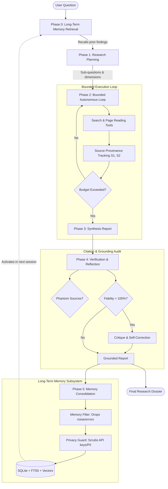

# Personal AI Research Agent

An autonomous, single-agent research architecture equipped with **budget boundaries**, **citation reflection/self-correction**, and **cross-session persistent memory**.

---

## Architecture Overview



---

## Key Features

1. **Autonomous Bounded Execution**:
   - Enforces operational boundaries: maximum tool calls, execution timeout, and token ceilings.
   - Self-terminates when adequate evidence is gathered.

2. **Source Provenance & Anti-Hallucination**:
   - Assigns explicit `[S1]`, `[S2]` tags to external sources.
   - Independent verification critic audits claims against raw excerpts and detects phantom citations.
   - Self-correction / reflection loop rewrites ungrounded claims.

3. **Persistent Cross-Session Memory**:
   - **Hybrid Retrieval**: Combines semantic embeddings (`gemini-embedding-001`) with full-text search (SQLite FTS5 BM25).
   - **Selective Persistence**: Stores only verified claims, sources, and comparison metrics. Drops raw HTML dumps, errors, and chit-chat.
   - **Zero-Trust Privacy Guard**: Redacts API keys, credentials, and emails before saving to disk.
   - **User Sovereignty**: Full CLI/API commands to list, inspect, delete, wipe, or export memories.

---

## Quick Start

### 1. Installation

```bash
pip install -r requirements.txt
```

### 2. Configuration

Set your API key in `.env`:
```env
GEMINI_API_KEY=your_gemini_api_key_here
LLM_MODEL=gemini-3.8-flash
```

### 3. Running the Agent

#### Interactive Cross-Session Mode:
```bash
python main.py
```

Try this continuous workflow:
- **Session 1:** `I'm researching Agentic RAG.`
  *(Agent gathers evidence, synthesizes report, verifies citations, and persists memory)*
- **Session 2:** `Continue my research and compare it with GraphRAG.`
  *(Agent retrieves Session 1 memory, uses it as baseline, and focuses on GraphRAG and comparisons)*

#### Single-Query Direct Execution:
```bash
python main.py --query "Compare traditional RAG, Agentic RAG, and GraphRAG"
```

#### Memory Management:
```bash
# List all stored research memories
python main.py --list-memories

# Delete a specific memory
python main.py --delete-memory mem_1714000000_1234

# Clear all stored memories
python main.py --clear-memories

# Export memories to JSON backup
python main.py --export-memories ./backup.json
```

---

## Running Tests

Run the complete 27-test verification suite:
```bash
pytest tests/ -v
```

Test coverage includes:
- SSRF protection & security boundaries (`test_research.py`)
- Tool argument validation & cycle detection (`test_agent.py`)
- Citation extraction, phantom detection, and reflection (`test_verifier.py`)
- Privacy scrubbing, hybrid retrieval, and consolidation (`test_memory.py`)
